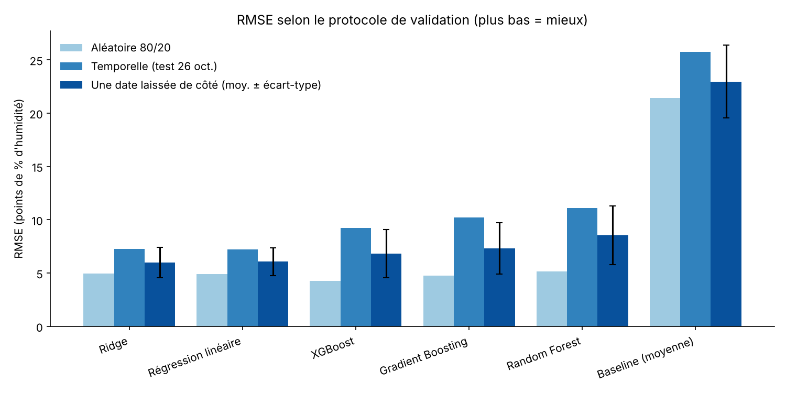

# 💧 Estimation de l'humidité au Sénégal

Projet Data Science (régression supervisée) : estimer l'humidité relative (%) dans les départements du Sénégal à partir de la température, de la vitesse du vent, des conditions météorologiques et de la localisation, avec une application Streamlit.

> Ce dépôt est une version personnelle de la partie Data Science d'un projet de hackathon réalisé en équipe. Il met l'accent sur la **rigueur de la validation** plus que sur le score brut.

## Objectif

1. Construire un pipeline de régression propre (prétraitement + modèle) sans fuite de données.
2. Comparer plusieurs modèles avec des protocoles de validation adaptés à la structure des données.
3. Proposer une application qui estime l'humidité à partir de conditions renseignées par l'utilisateur.

⚠️ **Ce projet n'est pas un système de prévision météorologique.** Le modèle estime l'humidité à partir de mesures fournies ; il n'a pas été validé pour prévoir le temps futur.

## Données

Fichier : `data/meteo_departements_Senegal.csv`

| Élément | Valeur |
|---|---|
| Lignes brutes | 900 |
| Après suppression des 135 doublons exacts | 765 |
| Régions / départements | 14 / 45 |
| Dates distinctes | **5** (18, 19, 20, 23 et 26 octobre 2025) |
| Colonnes | `region`, `departement`, `date`, `temperature`, `humidity`, `wind_speed`, `weather` |
| Cible | `humidity` (12 à 100 %, moyenne 59,6 %) |

Corrélation température–humidité : environ −0,87 (constat descriptif, pas une preuve de causalité).

**Droits de partage :** l'origine et la licence exactes du jeu de données ne sont pas documentées dans les fichiers fournis. Vérifiez les conditions d'utilisation de la source (et l'accord de l'équipe) avant de publier le CSV ; au besoin, décommentez la ligne `data/*.csv` dans `.gitignore`. L'application fonctionne sans le CSV (seul l'onglet « Données » est alors indisponible).

## Méthodologie

- **Nettoyage** : suppression des doublons exacts, conversion de `date`.
- **Variables retenues** : `region`, `departement`, `weather` (catégorielles, `OneHotEncoder(handle_unknown="ignore")`), `temperature`, `wind_speed` (numériques, `StandardScaler`).
- **Variables écartées** :
  - `month` : constante (tout est en octobre).
  - `day` : identifie la date de collecte, ne se généralise pas à une date jamais vue.
  - `hour` : testée avec et sans ; n'améliore pas la validation par date (voir ci-dessous), donc exclue.
- **Pipelines scikit-learn** : prétraitement et modèle sont dans un même `Pipeline`, ajusté uniquement sur les données d'entraînement de chaque pli (pas de fuite).
- **Hyperparamètres fixés a priori**, sans réglage sur un jeu de test.
- **Trois protocoles de validation** :
  1. *Séparation aléatoire 80/20* : référence optimiste (des observations très proches, même date et même région, se retrouvent en entraînement et en test).
  2. *Séparation temporelle* : entraînement sur 18, 19, 20 et 23 octobre, test sur le 26.
  3. *Une date laissée de côté* (leave-one-date-out, 5 plis) : chaque date est tour à tour le jeu de test. **C'est le protocole utilisé pour choisir le modèle.**

## Modèles comparés

Baseline (moyenne), régression linéaire, Ridge, Random Forest, Gradient Boosting, XGBoost.

## Résultats

Jeu de variables final (sans l'heure). Métriques en points de pourcentage d'humidité (MAE, RMSE) et R².

### Validation « une date laissée de côté » (critère de sélection)

| Modèle | MAE | RMSE (moy. ± écart-type) | R² |
|---|---:|---:|---:|
| **Ridge** | **4,76** | **5,98 ± 1,42** | **0,853** |
| Régression linéaire | 4,78 | 6,07 ± 1,32 | 0,848 |
| XGBoost | 5,58 | 6,81 ± 2,26 | 0,802 |
| Gradient Boosting | 5,99 | 7,31 ± 2,42 | 0,779 |
| Random Forest | 6,63 | 8,53 ± 2,75 | 0,689 |
| Baseline (moyenne) | 19,56 | 22,95 ± 3,43 | −1,153 |

### Séparation temporelle (test : 26 octobre, 270 observations)

| Modèle | MAE | RMSE | R² |
|---|---:|---:|---:|
| Régression linéaire | 5,63 | 7,19 | 0,875 |
| Ridge | 5,68 | 7,29 | 0,872 |
| XGBoost | 7,72 | 9,25 | 0,793 |
| Gradient Boosting | 8,71 | 10,23 | 0,747 |
| Random Forest | 9,18 | 11,09 | 0,702 |
| Baseline (moyenne) | 20,96 | 25,76 | −0,607 |

### Séparation aléatoire 80/20 (référence optimiste)

| Modèle | MAE | RMSE | R² |
|---|---:|---:|---:|
| XGBoost | 3,33 | 4,25 | 0,960 |
| Gradient Boosting | 3,75 | 4,77 | 0,950 |
| Régression linéaire | 3,81 | 4,93 | 0,946 |
| Ridge | 3,85 | 4,93 | 0,946 |
| Random Forest | 3,48 | 5,15 | 0,941 |
| Baseline (moyenne) | 18,46 | 21,40 | −0,013 |



### Ce que ces résultats montrent

- **Le classement change selon le protocole.** XGBoost est le meilleur en séparation aléatoire (RMSE 4,25) mais les modèles linéaires le devancent dès qu'on teste sur une date non vue. Les arbres sont plus sensibles au changement de date.
- **Modèle retenu : Ridge**, car il a le meilleur RMSE moyen en validation par date. Il est aussi simple et rapide, ce qui convient à l'application.
- **L'heure n'aide pas** : avec l'heure, Ridge obtient un RMSE moyen de 6,17 contre 5,98 sans.
- **La température porte l'essentiel du signal.** Une régression sur la seule température donne RMSE 10,86 et R² 0,74 en validation par date ; ajouter la localisation et les autres variables ramène le RMSE à environ 6. L'importance par permutation (test du 26 octobre) classe : température (10,2), région (3,9), département (2,7), conditions météo (0,5), vent (0,05).
- **Les erreurs varient selon la région** (MAE hors échantillon) : de 2,8 points (Thiès) à 7,4 (Kédougou) et 7,3 (Kolda).

### Limites

- **Seulement 5 journées** d'octobre 2025 : aucune information sur d'autres saisons ou années. Les performances ne disent rien sur la prévision du temps futur.
- **5 plis seulement** : les écarts entre modèles proches (Ridge vs régression linéaire) ne sont pas significatifs, et l'écart-type entre plis est élevé.
- Le modèle a été choisi parmi 12 candidats (6 modèles × avec/sans heure) sur les mêmes 5 plis : les scores du modèle retenu sont légèrement optimistes.
- Les hyperparamètres n'ont pas été réglés ; un réglage par validation imbriquée est une piste d'amélioration.
- L'importance par permutation décrit une association dans ce jeu de données, pas une relation causale.
- Le pipeline final est ré-entraîné sur les 5 dates ; ses performances futures ne sont pas mesurées.

## Structure du dépôt

```text
humidity-prediction-senegal/
├── data/
│   └── meteo_departements_Senegal.csv
├── models/
│   ├── humidity_pipeline.joblib     # pipeline complet (prétraitement + modèle)
│   └── metadata.json                # variables, plages, catégories, métriques
├── reports/
│   ├── figures/                     # graphiques générés
│   ├── results_*.csv                # tableaux de résultats
│   └── train_log.txt                # sortie complète de l'entraînement
├── docs/
│   └── fiche_entretien.md
├── train.py                         # nettoyage, validation, sélection, sauvegarde
├── app.py                           # application Streamlit
├── requirements.txt
├── README.md
└── .gitignore
```

## Lancer le projet

```bash
python -m venv .venv
source .venv/bin/activate          # Windows : .venv\Scripts\activate
pip install -r requirements.txt

python train.py                    # ré-entraîne, régénère modèle et figures
streamlit run app.py               # lance l'application
```

Le modèle sauvegardé nécessite une version de scikit-learn compatible avec celle utilisée pour l'entraînement (indiquée dans `models/metadata.json`) ; en cas de doute, relancez `python train.py`.

## Application Streamlit

- Saisie : région, département (filtré selon la région), conditions météo, température, vitesse du vent.
- Sortie : humidité estimée en %, interprétation, ordre de grandeur de l'erreur, avertissement si les valeurs sortent de la plage d'entraînement.
- Onglets : estimation, visualisations descriptives, modèle et limites.

## Technologies

Python, pandas, NumPy, scikit-learn, XGBoost, Matplotlib, joblib, Streamlit.

## Améliorations possibles

- Collecter plusieurs semaines ou saisons de données pour une vraie validation temporelle.
- Régler les hyperparamètres par validation imbriquée respectant les dates.
- Ajouter des variables (pression, point de rosée, altitude, distance à la côte) et tester des modèles par région.
- Quantifier l'incertitude (intervalles de prédiction).
